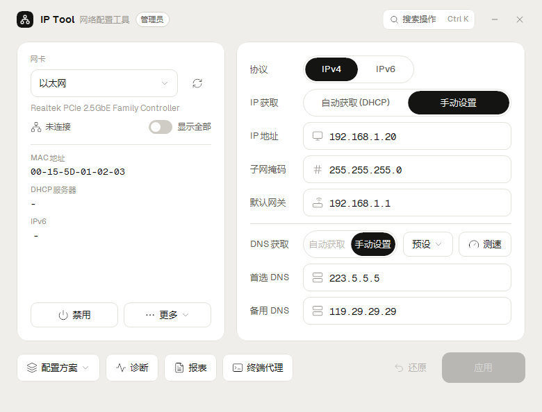
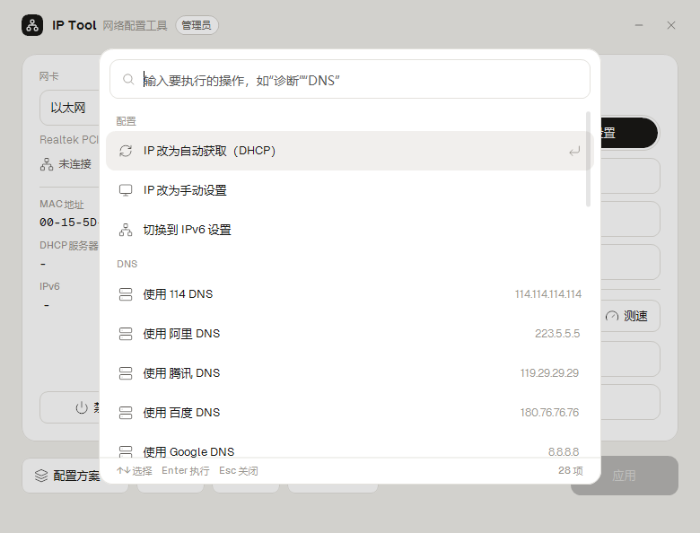
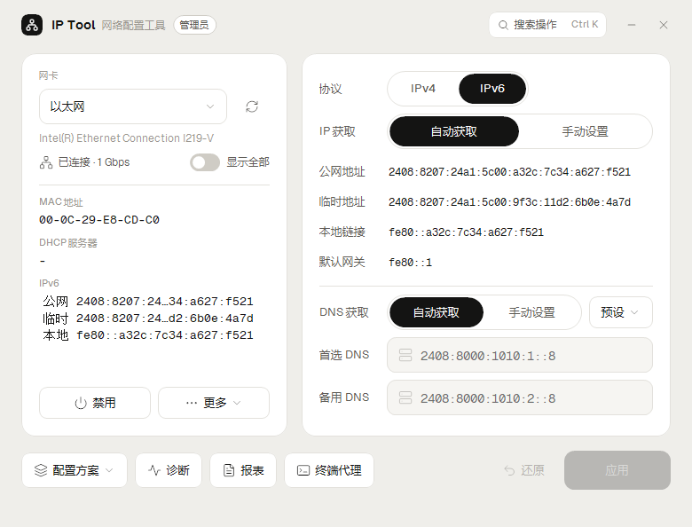
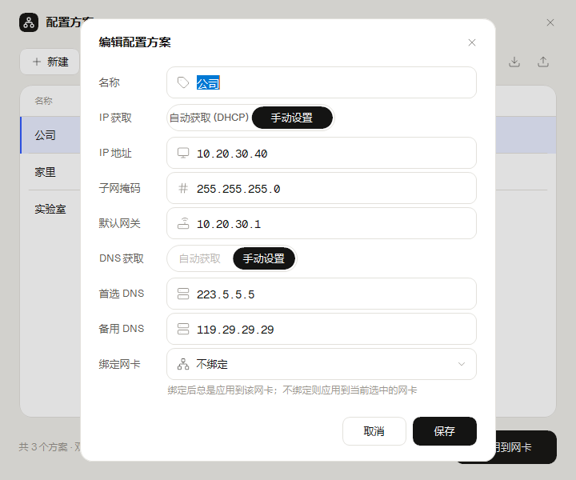
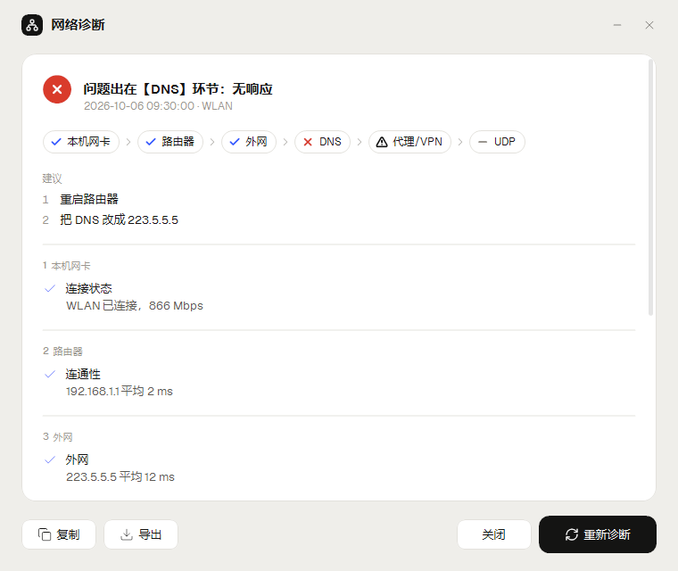
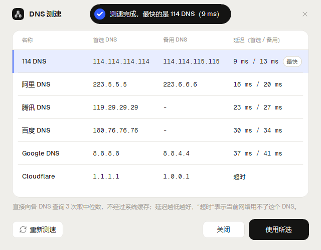
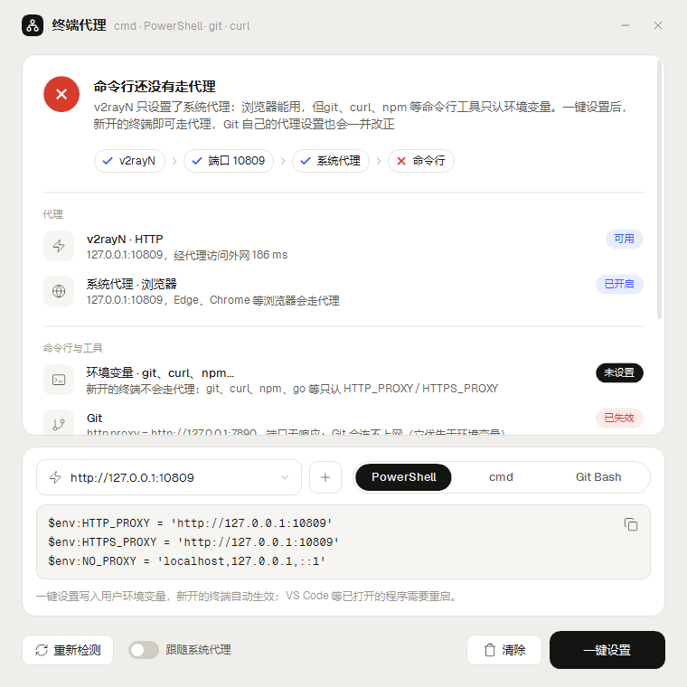
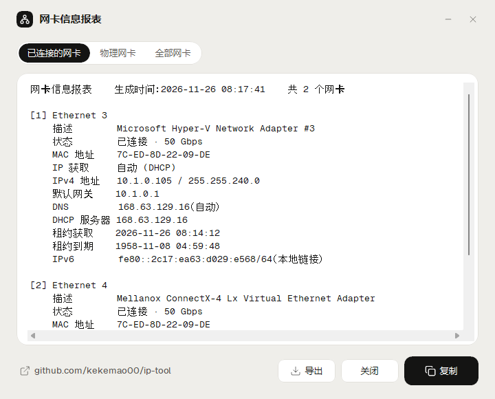
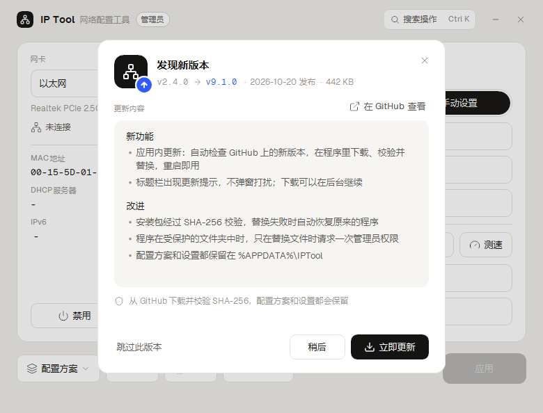

# IP Tool

[](https://github.com/kekemao00/ip-tool/releases/latest)
[](https://github.com/kekemao00/ip-tool/actions/workflows/build.yml)
[](LICENSE)


**Windows 网络配置与诊断工具。** 在公司和家里之间切换 IP、断网时找出断在哪一环、让 git 和 npm 跟着代理软件走——这些日常网络问题，一个免安装的小工具就能解决。



## 功能一览

- [网卡配置](#网卡配置)：静态 IP 与自动获取（DHCP）切换，支持 DHCP + 手动 DNS；输入即时校验，应用前检测 IP 冲突
- [IPv6](#ipv6)：手动设置地址、前缀长度、网关和 DNS；自动获取时按类别列出当前地址，网络没有 IPv6 时说明原因
- [配置方案](#配置方案)：保存常用配置，托盘菜单一键切换
- [网络诊断](#网络诊断与-dns-测速)：按“本机网卡 → 路由器 → 外网 → DNS → 代理/VPN → UDP”逐层检测，指出最先出问题的环节并给出处理建议
- [DNS 测速](#网络诊断与-dns-测速)：实测各公共 DNS 的延迟，一键使用最快的
- [终端代理](#终端代理)：找出代理软件的端口，一键设置 `HTTP_PROXY` 等环境变量，并改正 Git / npm / pip 中失效的代理
- [报表](#报表)与[命令行](#命令行)：导出网卡信息；在脚本中切换 IP、诊断网络
- [应用内更新](#应用内更新)：自动检查新版本，下载校验后重启即用
- 命令面板（Ctrl+K）：输入关键字即可执行以上大部分操作

## 下载

在 [Releases](https://github.com/kekemao00/ip-tool/releases/latest) 下载 zip，解压后运行 `IPTool.exe`，无需安装。

- 需要 .NET Framework 4.8：Windows 10 1903 及以上、Windows 11 已自带
- 请把 `IPTool.exe.config` 和 exe 放在一起（其中有高 DPI 设置）
- 每个 Release 附有 `SHA256SUMS.txt`，可用于校验下载的文件
- 从 v2.3.0 起，新版本可以在程序内直接更新，见[应用内更新](#应用内更新)；从 v2.2.2 及更早的版本升级时，需要手动下载一次

## 功能

### 网卡配置
- 查看网卡信息：IPv4、子网掩码、网关、DNS（区分自动 / 手动）、MAC、DHCP 服务器与租约、IPv6 地址（标明公网 / 临时 / 本地链接等类别）
- 配置卡片顶部的“协议”可切换 IPv4 / IPv6（IPv6 见[下一节](#ipv6)）；IPv4 支持静态 IP 与自动获取（DHCP）切换，支持 **DHCP + 手动 DNS**
- 输入即时校验：IP 格式、掩码是否连续、网关是否在同一网段、是否为网段或广播地址；可直接输入 `192.168.1.10/24`
- 应用前检测 IP 冲突（同网段 ARP 探测）；修改当前上网的网卡前再次确认
- DNS “预设”中有常用公共 DNS，可测速后选择，也可以把当前 DNS 保存为自定义预设
- 单个网卡启用 / 禁用；“更多”菜单中可续订 DHCP 租约、启用或禁用列表中的所有网卡、打开系统“网络连接”
- 命令面板（Ctrl+K，或点标题栏的“搜索操作”）：搜索并执行配置方案、DNS 预设、诊断、终端代理等操作
- 网络变化时自动刷新；默认只列出物理网卡，打开“显示全部”可查看虚拟网卡



### IPv6
配置卡片顶部的“协议”切到 IPv6，设置项与系统“Internet 协议版本 6 (TCP/IPv6) 属性”一致：

- 手动设置地址、前缀长度、默认网关和 DNS；可直接输入 `2001:db8::10/64`，DNS “预设”中有阿里、腾讯、百度、Google、Cloudflare 公共 DNS 的 IPv6 地址
- 与系统设置一样，手动地址加在路由器分配（SLAAC / DHCPv6）的地址之外，不会关掉自动配置；改回自动获取会删除手动设置的地址和网关
- 自动获取时列出当前的 IPv6 地址并标明类别（公网 / 临时 / 内网 / 本地链接等）和默认网关，完整地址可以选中复制，悬停可看前缀长度和说明
- 网络没有提供 IPv6（如路由器未开启 IPv6、虚拟机的 NAT 网络，只有 fe80 开头的本地链接地址）时说明原因；网卡未连接、未启用 IPv6 时也有说明
- 手动设置后检查重复地址检测（DAD）的结果，地址已被网段内其他设备使用时提示，并撤销这次新加的地址
- 只改了 IPv4 或只改了 IPv6 时，应用时不会重设另一个
- 配置方案和命令行目前只包含 IPv4 设置



### 配置方案
- 保存、编辑、复制、排序、删除配置方案，可绑定到指定网卡（按 MAC）
- 导入 / 导出 JSON（兼容旧版本导出的文件），导入时可选择覆盖或跳过同名方案
- 托盘菜单一键切换方案；可设置“关闭时最小化到托盘”“开机自动启动”



### 网络诊断与 DNS 测速
- 分层诊断：按“本机网卡 → 路由器 → 外网 → DNS → 代理/VPN → UDP”的顺序逐个环节检测，指出最先出问题的环节，并给出每一项的排查或处理建议；可复制或导出 TXT（附网卡信息）/ JSON
  - 本机网卡：连接状态、IP 是否为 169.254.x.x（DHCP 失败）、网关是否同网段、多个网卡都有默认网关、Wi-Fi 信号强度
  - 路由器：丢包与延迟（ping 不通时用 ARP 判断路由器是否在线）、双重 NAT（光猫 + 路由器）、运营商级 NAT（没有公网 IPv4）
  - 外网：ping、TCP、HTTP（直连，不经代理）分别检测，可识别禁 ping 网络和需要网页认证的网络；HTTPS 证书被替换；路径 MTU
  - DNS：各 DNS 服务器直接查询、系统解析、DNS 劫持（不存在的域名被解析）、hosts 自定义条目
  - 代理/VPN：系统代理、PAC、WinHTTP 代理、HTTP_PROXY 等环境变量是否可连接（代理软件退出后残留的系统代理是常见的“有网但打不开网页”原因）；代理是否真正可用；VPN / TUN 网卡与默认路由、Fake-IP（198.18.x.x）、正在运行的代理程序、国际网站可达性；系统代理可用但没有设置代理环境变量时，提示可用[终端代理](#终端代理)一键设置
  - UDP：公共 DNS（UDP 53）与 STUN（UDP 3478）是否有应答，识别 UDP 被封锁或只放行 DNS；根据 STUN 结果判断 NAT 类型（对称型 NAT 会影响 P2P 联机、游戏语音）
- DNS 测速：直接向各公共 DNS 发送查询（不经过系统缓存），按延迟排序后一键使用；可保存自定义 DNS 预设





### 终端代理
v2rayN、Clash 等代理软件只设置系统代理，浏览器能用，但在 cmd、PowerShell 里运行的 git、curl、npm、go 等只认环境变量，不会跟着走代理。主窗口点“终端代理”（或命令面板搜“代理”）：
- 一键检查：找出正在运行的代理软件和它监听的本机端口（自动识别 HTTP / SOCKS5），HTTP 端口会实测经代理访问外网；逐项检查系统代理、用户 / 系统环境变量、Git / npm / pip 自己的代理设置（它们优先于环境变量）和 WinHTTP，标出“未设置”“不一致”“已失效”（指向的端口没有程序在监听）
- 一键设置：把 `HTTP_PROXY`、`HTTPS_PROXY`（以及缺少时的 `NO_PROXY`，含系统代理的例外列表）写入用户环境变量并通知系统，之后新开的终端即可走代理；Git（含只对某个网站生效的 `http.<url>.proxy`）/ npm / pip 中已单独设置、但指向别处的代理一并改正，原来的值会备份
- 手动添加：SSH 隧道（如 `ssh -D 1080`）、局域网里的代理服务器等检测不到的代理，点代理地址右侧的“+”，填写地址、端口和类型（HTTP / SOCKS5），也可以直接粘贴 `socks5://127.0.0.1:1080`；之后同样可以实测、一键设置或复制命令，添加的代理会保存，下次打开仍在列表中
- 清除：删除指向本机代理的设置，恢复设置前的值（如公司代理）；关掉代理软件后 git 连不上网时用它。系统级环境变量需要管理员在“系统属性”中删除，会给出提示
- 已打开的终端：按 PowerShell / cmd / Git Bash 生成命令，复制粘贴即可立即生效
- 跟随系统代理：开启后，代理软件开关系统代理或换端口时自动设置或清除命令行代理（需要程序在托盘运行）



### 报表
- 按“已连接 / 物理网卡 / 全部网卡”筛选，可复制或导出为 TXT / JSON；IPv6 地址全部列出并标明类别



### 应用内更新
- 启动后和之后每隔约一天在后台检查 GitHub Releases；有新版本时标题栏右侧出现“新版本”提示，不弹窗打扰
- 点开可查看更新内容，一键下载（可在后台继续，进度显示在标题栏），下载后用 `SHA256SUMS.txt` 校验并确认程序版本
- “重启并更新”会替换 `IPTool.exe` 和 `IPTool.exe.config` 后自动重新打开，未应用的修改会带过去；替换失败时自动恢复原文件。程序在 Program Files 等受保护的文件夹中时，替换时请求一次管理员权限
- 可跳过某个版本；在“更多”菜单、托盘菜单或命令面板中可手动检查更新、关闭自动检查



## 使用说明

- 普通权限启动即可查看；修改配置需要管理员权限，程序会提示以管理员身份重启，已填写的内容（包括 IPv4、IPv6 两页未应用的修改）会自动带过去
- 未连接的网卡（未插网线、Wi-Fi 未连接）只能改为自动获取或修改 DNS：Windows 无法关闭未连接网卡的 DHCP，设置的静态 IP 不能可靠生效。请先插好网线或连接 Wi-Fi（对端没有 DHCP 服务也可以），再设置静态 IP
- Hyper-V 等由系统管理的虚拟网卡只能查看
- 按 Ctrl+K 打开命令面板，输入关键字（如“诊断”“DNS”“代理”或方案名）即可执行对应操作
- 配置方案和设置保存在 `%APPDATA%\IPTool\`，下载的更新包在 `%LOCALAPPDATA%\IPTool\updates\`

## 命令行

```
IPTool.exe --list [--json]
IPTool.exe --diagnose [--adapter <网卡>] [--json]
IPTool.exe --adapter <网卡> --static <IP>[/<前缀>] [--mask <掩码>] [--gateway <网关>] [--dns <DNS1>[,<DNS2>]]
IPTool.exe --adapter <网卡> --dhcp [--dns <DNS1>[,<DNS2>]]
IPTool.exe --adapter <网卡> --profile <配置方案名称>
IPTool.exe --adapter <网卡> --enable | --disable
```

- `<网卡>` 可以是连接名称（如 `以太网`、`WLAN`）、接口索引或网卡 GUID
- `--diagnose` 进行分层网络诊断，不指定网卡时诊断当前上网的网卡；不需要管理员权限，发现问题时退出码为 6
- `--static` 未指定 `--gateway` 时不设网关，未指定 `--dns` 时清空 DNS；`--dhcp` 未指定 `--dns` 时 DNS 也自动获取
- `--static`、`--dhcp`、`--profile` 只修改 IPv4 设置
- 非管理员运行时会请求提权；加 `--no-elevate` 则不提权，直接以退出码 5 结束
- 退出码：0 成功，1 参数错误，2 找不到网卡，3 配置无效，4 应用失败，5 需要管理员权限，6 诊断发现问题
- 本程序是窗口程序：在 cmd 中用 `start /wait` 运行才能拿到退出码，PowerShell 中可用 `Start-Process -Wait -PassThru`

```bat
start /wait IPTool.exe --adapter 以太网 --static 192.168.1.100/24 --gateway 192.168.1.1 --dns 223.5.5.5,119.29.29.29
start /wait IPTool.exe --adapter 以太网 --dhcp
IPTool.exe --diagnose > 诊断.txt
```

## 构建

只需要 [.NET SDK](https://dotnet.microsoft.com/download)（已用 10.0 验证），不需要安装 Visual Studio：

```bash
dotnet build IP_UpdateTest.sln -c Release   # 输出在 IP_UpdateTest/bin/Release/net48/
dotnet test IP_UpdateTest.sln
```

### 界面截图

README 中的截图由界面冒烟测试 `IP_UpdateTest.Tests/UiSnapshotTests.cs` 用固定的示例数据渲染（报表截图除外，它读取运行测试的机器上的网卡）。设置环境变量 `UI_SNAPSHOT_DIR` 后运行测试，即可把各窗口保存为 PNG：

```powershell
$env:UI_SNAPSHOT_DIR = "$PWD\ui-snapshots"; dotnet test IP_UpdateTest.sln
```

CI 每次构建都会把截图上传为 `ui-snapshots` artifact，不需要 Windows 环境也能取到：`gh run download <run-id> -n ui-snapshots -D ui-snapshots`。界面有变化时，按下表把对应文件复制到 `screenshots/`：

| README 截图 | 快照文件 |
|---|---|
| `main.png` | `main-admin.png` |
| `command_palette.png` | `main-admin-palette.png` |
| `ipv6.png` | `main-admin-ipv6.png` |
| `profile.png` | `profiles-edit.png` |
| `diagnose.png` | `diagnosis.png` |
| `dns_benchmark.png` | `dns-benchmark.png` |
| `terminal_proxy.png` | `terminal-proxy.png` |
| `generate_report.png` | `info.png` |
| `update.png` | `update-available.png` |

## 发布

推送到 main 后，GitHub Actions 会构建并运行测试；如果 `IP_UpdateTest/IP_UpdateTest.csproj` 中的 `<Version>` 还没有对应的 Release，会自动创建标签 `v<版本号>` 并发布 Release（附 zip 和 SHA256SUMS.txt）。版本号不变时只构建，不发布。

发布新版本：

1. 修改 `IP_UpdateTest/IP_UpdateTest.csproj` 中的 `<Version>`
2. 在 `CHANGELOG.md` 中添加对应版本的小节（如 `## v2.0.1`），内容会作为 Release 说明，也会显示在程序内的更新面板里（支持 `###` 小标题和 `-` 列表；小节内不要用 `##`，否则说明会在那里截断）
3. 同步更新 README：新功能写进“功能”，界面有变化时按[界面截图](#界面截图)更新 `screenshots/`
4. 提交并推送到 main

提交 PR 时 CI 就会检查：版本号还没有对应的 Release 时，CHANGELOG 中要有这个版本的小节，且版本号要高于最新的 Release。

## 技术栈

- C# / .NET Framework 4.8 / Windows Forms（SDK 风格项目）
- 网卡信息：`System.Net.NetworkInformation`、WMI `MSFT_NetAdapter`
- 修改配置：WMI `Win32_NetworkAdapterConfiguration`；未连接网卡和清除网关使用 `netsh`
- IPv6：手动设置的地址和网关从 WMI `MSFT_NetIPAddress` / `MSFT_NetRoute` 读取，用 `netsh interface ipv6` 修改
- 终端代理：用 `GetExtendedTcpTable` 找出代理程序监听的端口；用户环境变量写入注册表 `HKCU\Environment` 后广播 `WM_SETTINGCHANGE`
- 应用内更新：GitHub Releases API，下载后按 `SHA256SUMS.txt` 校验

## 反馈

遇到问题或有建议，欢迎提交 [Issue](https://github.com/kekemao00/ip-tool/issues)。反馈网络问题时，附上“诊断”导出的 TXT 会更容易定位。

## License

本项目基于 [Apache License 2.0](LICENSE) 开源。界面字体 Geist / Geist Mono 基于 SIL Open Font License 1.1（见 [OFL.txt](IP_UpdateTest/Fonts/OFL.txt)）。
